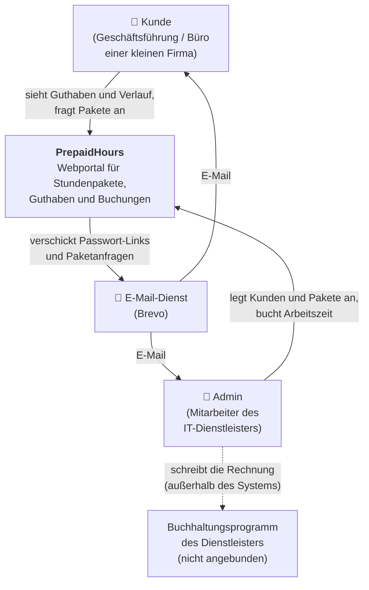
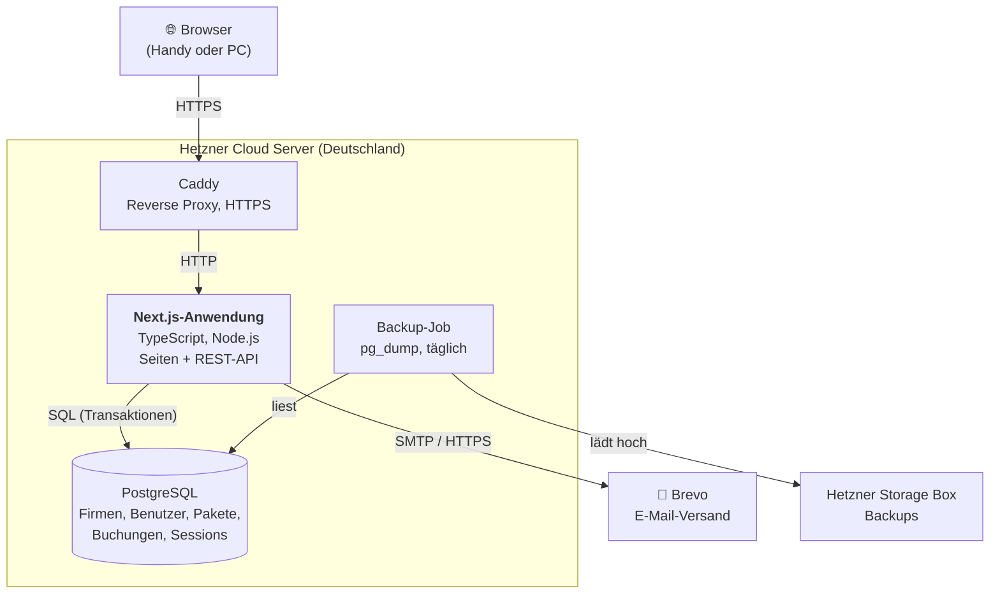
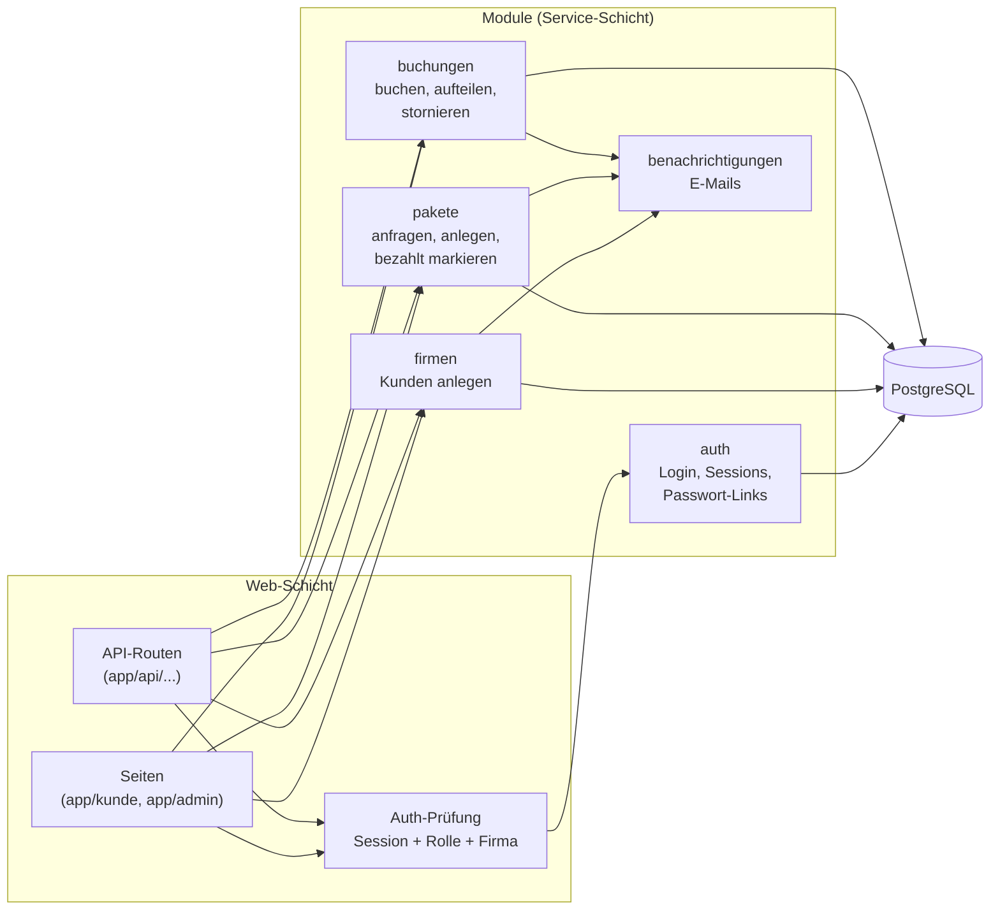
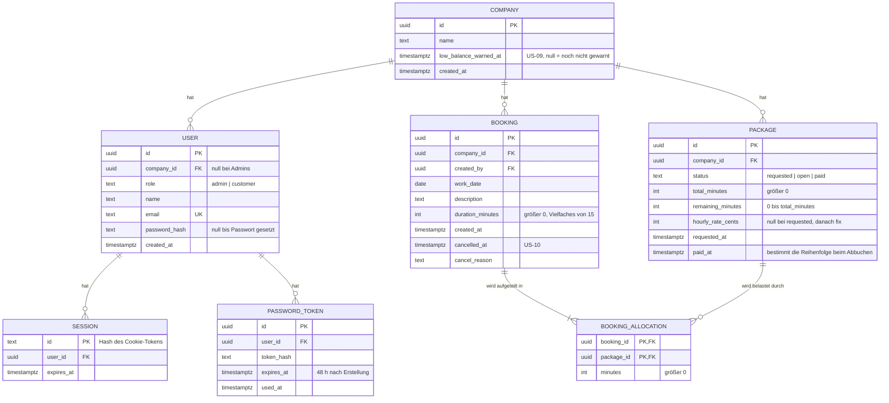
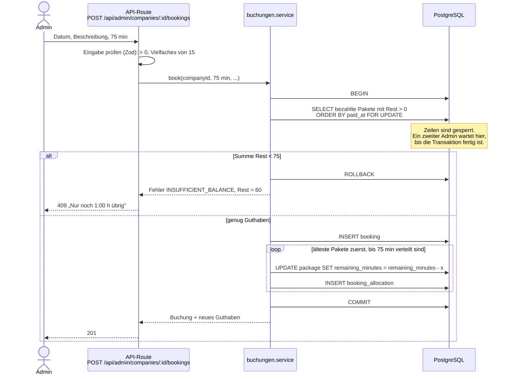

# Architektur

Dieses Dokument beschreibt, wie PrepaidHours aufgebaut ist und warum. Grundlage sind die Anforderungen aus `docs/requirements.md` und der MVP-Umfang aus `docs/mvp.md`. Die wichtigsten Entscheidungen stehen zusätzlich als ADRs in `docs/adr/`.

## Was die Architektur leisten muss

Aus den Anforderungen ergeben sich ein paar Punkte, die die Architektur stärker beeinflussen als der Rest:

- **Nie überbuchen (US-08, NFA-01):** Das Guthaben darf auch bei gleichzeitigen Buchungen nicht negativ werden. Das muss in der Datenbank abgesichert sein, nicht nur im Frontend. Das ist die wichtigste technische Anforderung.
- **Buchung auf mehrere Pakete aufteilen (US-07, FA-07):** Es wird immer zuerst vom ältesten bezahlten Paket abgezogen. Eine Buchung kann auf zwei Pakete aufgeteilt werden.
- **Daten getrennt halten (FA-02, NFA-02):** Ein Kunde darf nie Daten einer anderen Firma sehen, auch nicht über eine geänderte URL.
- **E-Mails (US-04, US-05):** Paketanfrage und Passwort-Link verschicken. Wenn die E-Mail nicht klappt, darf die Anfrage nicht verloren gehen.
- **Klein und günstig:** Zwei Rollen, ein paar Seiten, wenige Benutzer. Hosting in der EU, wenig Kosten, und wir müssen es im Semester selbst bauen und betreiben können.

## Architekturvarianten

Wir haben zwei Varianten verglichen.

### Variante A: Modularer Monolith (Next.js + PostgreSQL)

Eine einzige Anwendung, die die Seiten rendert und die API bereitstellt. Innen ist sie in Module aufgeteilt (Auth, Firmen, Pakete, Buchungen, Benachrichtigungen). Jedes Modul hat seine eigene Service-Schicht, und nur die Service-Schicht spricht mit der Datenbank. Es gibt eine PostgreSQL-Datenbank.

### Variante B: Getrenntes Frontend und Backend (React-SPA + REST-API + PostgreSQL)

Ein React-Frontend als Single-Page-App, das im Browser läuft, und ein eigenes Backend (z. B. Node.js mit Express) mit einer REST-API. Beides wird getrennt gebaut und deployt. Dazu dieselbe PostgreSQL-Datenbank.

### Vergleich

| Kriterium | A: Modularer Monolith | B: SPA + eigene API |
|---|---|---|
| Aufwand für uns | Gering: ein Projekt, eine Sprache, ein Deployment | Höher: zwei Projekte, zwei Builds, CORS und Token-Handling zwischen beiden |
| Sicherheit (NFA-02) | Session-Cookie im selben Origin, Berechtigungen werden auf dem Server geprüft, bevor die Seite gerendert wird | Token im Browser, jede API-Route muss extra abgesichert werden, mehr Stellen für Fehler |
| Überbuchungsschutz (NFA-01) | Gleich gut: liegt in beiden Fällen in der Datenbank-Transaktion | Gleich gut |
| Ladezeit (NFA-03) | Seiten kommen fertig gerendert vom Server, wenig JavaScript am Handy | Erst JavaScript laden, dann Daten holen, auf schwachen Handys langsamer |
| Hosting und Kosten | Ein Container + Datenbank | Zwei Dienste oder Static Hosting + API-Server |
| Später erweiterbar | Module lassen sich bei Bedarf herauslösen | Frontend und Backend schon getrennt, z. B. für eine eigene App |
| Passt zum Umfang | Ja | Überdimensioniert für zwei Rollen und ca. 10 Seiten |

Ein dritter Ansatz wären Microservices (je ein Dienst für Pakete, Buchungen, Mails). Den haben wir nicht genauer angeschaut. Die Überbuchungsprüfung braucht Pakete und Buchungen in **einer** Transaktion, und genau das wird schwer, wenn beide in getrennten Diensten liegen.

### Entscheidung

Wir nehmen **Variante A**. Der Hauptgrund ist, dass B uns mehr Arbeit macht, ohne eine Anforderung besser zu erfüllen. Der einzige Vorteil von B (eine eigene App kann dieselbe API benutzen) ist laut `mvp.md` bewusst ausgeschlossen. Details stehen in [ADR-001](adr/001-modularer-monolith-nextjs.md).

## Technologieauswahl

| Bereich | Wahl | Warum | Alternative, die wir verworfen haben |
|---|---|---|---|
| Sprache | TypeScript | Eine Sprache für Frontend und Backend, Typfehler fallen beim Bauen auf | JavaScript ohne Typen |
| Framework | Next.js (App Router) | Server-Rendering und API-Routen in einem Projekt, große Doku | Remix / React Router; vergleichbar, aber das Team kennt Next.js |
| Datenbank | PostgreSQL | Echte Transaktionen, `SELECT … FOR UPDATE` und `CHECK`-Constraints, die wir für NFA-01 brauchen | SQLite: einfacher, aber nur ein Schreiber gleichzeitig und schwächer im Betrieb mit mehreren Prozessen |
| Datenbankzugriff | Drizzle ORM + SQL-Migrationen | Nah an SQL, unterstützt `.for('update')` direkt, Migrationen sind lesbare SQL-Dateien | Prisma: verbreiteter, aber Zeilensperren gehen nur über Raw-SQL |
| Login | Eigene Sessions in der Datenbank, Passwörter mit Argon2id | Wenig Code, gut erklärbar, erfüllt NFA-02, Session kann serverseitig gelöscht werden | Auth.js: kann viel, was wir nicht brauchen (OAuth), und der Login mit Passwort ist dort umständlich |
| Formulare | Validierung mit Zod, auf dem Server | Dieselben Regeln (15-Minuten-Schritte, Werte > 0) im Formular und in der API | Nur HTML-Validierung im Browser: kann umgangen werden |
| E-Mail | Brevo (SMTP / API) | Firma in Frankreich, Server in der EU, Free-Plan mit 300 Mails pro Tag | Resend: gute API, aber US-Firma |
| Tests | Vitest (Logik), Playwright (Ablauf aus `mvp.md`) | Der Überbuchungstest aus NFA-01 läuft gegen eine echte PostgreSQL | Nur manuelle Tests |
| Betrieb | Docker Compose auf einem Hetzner-Server | Siehe `docs/hosting.md` und [ADR-003](adr/003-hosting-hetzner-docker-compose.md) | Managed PaaS |

## Architekturdiagramm

Die Diagramme folgen dem C4-Modell. Sie sind in Mermaid geschrieben, damit GitHub sie direkt anzeigt.

### Ebene 1: Systemkontext



### Ebene 2: Container



### Ebene 3: Komponenten in der Next.js-Anwendung



Regeln für die Module:

- Seiten und API-Routen enthalten keine Geschäftslogik. Sie prüfen die Eingabe, rufen einen Service auf und zeigen das Ergebnis.
- Nur die Services greifen auf die Datenbank zu. Dadurch gibt es genau eine Stelle, an der eine Buchung entsteht, egal ob über das Formular oder die API.
- Jede Abfrage für Kunden filtert nach der `company_id` aus der Session, nie nach einer ID aus der URL (NFA-02).
- E-Mails werden **nach** dem Speichern verschickt. Schlägt der Versand fehl, wird das geloggt, aber die Anfrage bleibt gespeichert und ist für den Admin sichtbar (`mvp.md`, Externe Dienste).

## Datenmodell



Entscheidungen zum Datenmodell:

- **Zeiten in ganzen Minuten.** Gespeichert wird `int` und kein `decimal` oder `float`. 1:15 h sind 75. So gibt es keine Rundungsfehler, und „Vielfaches von 15" ist eine einfache `CHECK`-Bedingung. Angezeigt wird `h:mm`.
- **Geld in Cent.** `hourly_rate_cents` ist ein `int`, aus demselben Grund.
- **Restguthaben wird pro Paket gespeichert.** `remaining_minutes` hat den Constraint `CHECK (remaining_minutes >= 0 AND remaining_minutes <= total_minutes)`. Das Guthaben eines Kunden ist die Summe von `remaining_minutes` über seine bezahlten Pakete. Warum wir das speichern und nicht jedes Mal ausrechnen, steht in [ADR-002](adr/002-ueberbuchungsschutz-in-der-datenbank.md).
- **Aufteilung über `booking_allocation`.** Eine Buchung über 1:00 h, die 0:30 h vom ersten und 0:30 h vom zweiten Paket nimmt, hat zwei Zeilen. So sieht man später genau, aus welchem Paket welche Minuten kamen, und eine Stornierung (US-10) kann die Minuten an genau diese Pakete zurückgeben.
- **Paketstatus (FA-04):** `requested` = vom Kunden angefragt, `open` = vom Admin mit Stundensatz bestätigt und Rechnung verschickt, `paid` = bezahlt. Nur `paid` zählt zum Guthaben (FA-03). Beim Wechsel auf `paid` wird `remaining_minutes = total_minutes` gesetzt.
- **Stundensatz unveränderlich (US-06):** Sobald ein Paket `open` ist, lehnt der Service jede Änderung von `hourly_rate_cents` ab. Ein Test prüft das.
- **Stornieren statt löschen (US-10, FA-10):** Buchungen werden nie gelöscht, nur mit `cancelled_at` und `cancel_reason` markiert.
- **Wichtige Constraints und Indizes:** `UNIQUE (lower(email))` auf `user` (US-05). Index auf `booking (company_id, work_date DESC)` für den Verlauf (NFA-03). Index auf `package (company_id, status, paid_at)` für das Abbuchen.

## Ablauf einer Buchung

Das ist der Kern von US-07 und US-08. Alles passiert in **einer** Datenbank-Transaktion:



Zwei Sicherungen gegen das Überbuchen:

1. **Zeilensperre (`FOR UPDATE`):** Zwei gleichzeitige Buchungen für dieselbe Firma laufen nacheinander. Die zweite sieht schon das reduzierte Guthaben.
2. **`CHECK`-Constraint:** Würde trotzdem ein Paket unter 0 fallen (z. B. durch einen Fehler in unserem Code), bricht die Datenbank die ganze Transaktion ab.

Der Test aus NFA-01 (10 gleichzeitige Buchungen zu je 1 h auf 5 h Guthaben, genau 5 gehen durch) läuft gegen eine echte PostgreSQL in Docker, nicht gegen einen Mock.

## API-Design

REST mit JSON. Alle Routen liegen unter `/api`. Die Seiten selbst rufen die Services direkt auf dem Server auf. Die API benutzen Formulare und die Playwright-Tests. Authentifiziert wird mit einem Session-Cookie (`HttpOnly`, `Secure`, `SameSite=Lax`).

### Auth

| Methode | Pfad | Wer | Zweck | Story |
|---|---|---|---|---|
| POST | `/api/auth/login` | alle | E-Mail + Passwort → Session-Cookie | US-01 |
| POST | `/api/auth/logout` | eingeloggt | Session löschen | US-01 |
| POST | `/api/auth/set-password` | mit Link | Token + neues Passwort → Passwort setzen | US-05 |

### Kunde (nur eigene Firma, Firma kommt aus der Session)

| Methode | Pfad | Zweck | Story |
|---|---|---|---|
| GET | `/api/me/balance` | Guthaben in Minuten + Pakete, die auf Zahlung warten | US-02 |
| GET | `/api/me/bookings?page=1` | Verlauf, neueste zuerst, 50 pro Seite | US-03 |
| GET | `/api/me/packages` | Eigene Pakete mit Status | US-02 |
| POST | `/api/me/packages` | Paket anfragen `{ hours }` | US-04 |
| GET | `/api/me/bookings.csv` | Verlauf als CSV | US-11 |

### Admin

| Methode | Pfad | Zweck | Story |
|---|---|---|---|
| GET | `/api/admin/companies` | Alle Firmen mit Guthaben | – |
| POST | `/api/admin/companies` | Firma + Kunden anlegen `{ companyName, name, email }`, verschickt Passwort-Link | US-05 |
| GET | `/api/admin/companies/:id` | Firma mit Paketen und Buchungen | – |
| POST | `/api/admin/companies/:id/packages` | Paket anlegen `{ hours, hourlyRateCents }` → Status `open` | US-06 |
| POST | `/api/admin/packages/:id/confirm` | Angefragtes Paket bestätigen `{ hourlyRateCents }` → `open` | US-04, US-06 |
| POST | `/api/admin/packages/:id/mark-paid` | `open` → `paid`, Guthaben steigt | US-06 |
| POST | `/api/admin/companies/:id/bookings` | Arbeit buchen `{ workDate, description, durationMinutes }` | US-07, US-08 |
| POST | `/api/admin/bookings/:id/cancel` | Buchung stornieren `{ reason }` | US-10 |

Für Statuswechsel verwenden wir eigene Aktionen (`/confirm`, `/mark-paid`, `/cancel`) statt eines allgemeinen `PATCH`. Damit kann man zum Beispiel keinen Stundensatz über ein `PATCH` ändern, und jeder erlaubte Übergang hat genau eine Route.

### Antworten und Fehler

Fehler haben immer dieselbe Form:

```json
{ "error": { "code": "INSUFFICIENT_BALANCE", "message": "Nur noch 1:00 h Guthaben übrig.", "remainingMinutes": 60 } }
```

| HTTP | Code | Wann |
|---|---|---|
| 400 | `VALIDATION_ERROR` | Eingabe ungültig, z. B. 20 Minuten oder Stundensatz 0 |
| 401 | `UNAUTHENTICATED` | Nicht eingeloggt oder falsche Login-Daten (gleiche Meldung für unbekannte E-Mail und falsches Passwort, US-01) |
| 403 | `FORBIDDEN` | Kunde ruft Admin-Route auf |
| 404 | `NOT_FOUND` | Gibt es nicht **oder** gehört zu einer anderen Firma. Wir verraten nicht, dass es die ID gibt (NFA-02). |
| 409 | `INSUFFICIENT_BALANCE` | Buchung größer als Guthaben (US-08) |
| 409 | `EMAIL_TAKEN` | E-Mail schon vergeben (US-05) |
| 409 | `INVALID_STATUS` | Falscher Statuswechsel, z. B. `requested` → `paid` |
| 410 | `TOKEN_EXPIRED` | Passwort-Link älter als 48 h (US-05) |

## Wie die Architektur die nichtfunktionalen Anforderungen erfüllt

| NFA | Wie |
|---|---|
| NFA-01 Nie negativ | Transaktion mit `FOR UPDATE` + `CHECK (remaining_minutes >= 0)`, siehe ADR-002. Test mit 10 parallelen Buchungen. |
| NFA-02 Sicherheit | Argon2id, Session-Cookie `HttpOnly`, Firma immer aus der Session, fremde IDs geben 404. Test: Kunde A ruft Daten von Kunde B auf. |
| NFA-03 < 2 s bei 1000 Buchungen | Guthaben ist eine Summe über wenige Pakete (nicht über alle Buchungen), Verlauf mit Index und 50 pro Seite, Server-Rendering. Messung mit Seed-Daten. |
| NFA-04 Handy ab 360 px | Ein Layout mit einer Spalte, Tabellen werden am Handy zu Karten. Test in Playwright mit 360 px Breite. |

## Projektstruktur (geplant)

```
src/
  app/                 Seiten und API-Routen (Next.js App Router)
    (kunde)/           Dashboard, Verlauf, Paket anfragen
    admin/             Firmen, Pakete, Buchen
    api/               REST-Routen wie oben
  modules/
    auth/              service.ts, session.ts, password.ts
    firmen/            service.ts
    pakete/            service.ts
    buchungen/         service.ts, allocate.ts (Aufteilen auf Pakete)
    benachrichtigungen/ service.ts, mailer.ts (Brevo oder Konsole lokal)
  db/
    schema.ts          Drizzle-Schema
    migrations/        SQL-Migrationen
tests/
  unit/                Vitest
  integration/         Vitest gegen PostgreSQL in Docker (u. a. NFA-01)
  e2e/                 Playwright, Ablauf aus mvp.md
```
