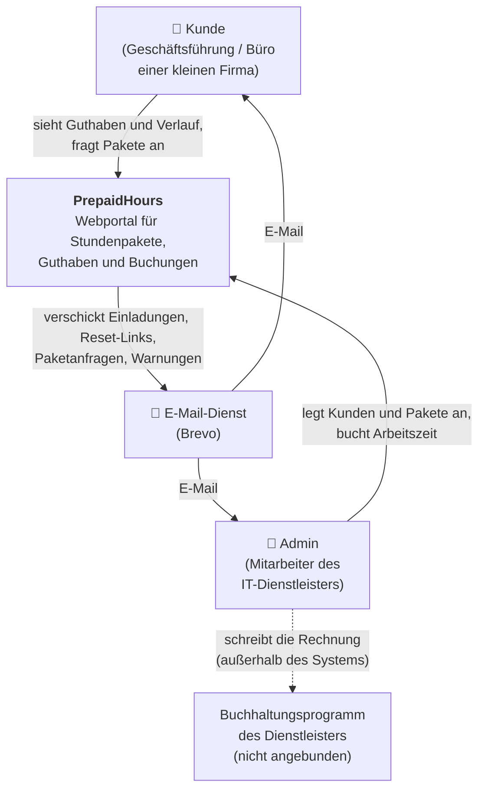
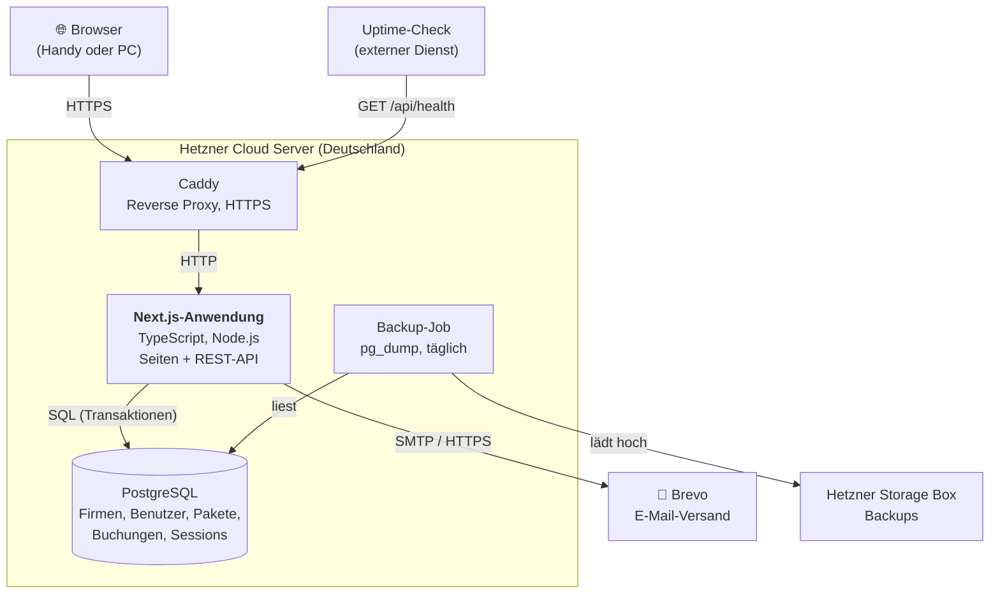
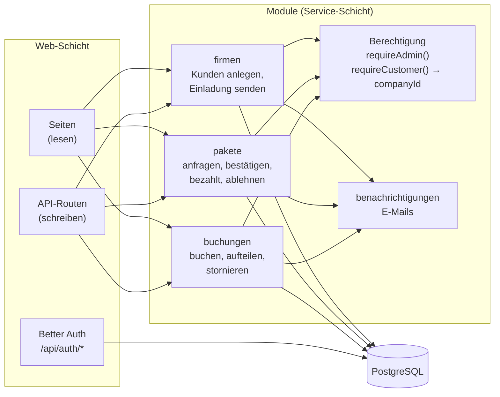
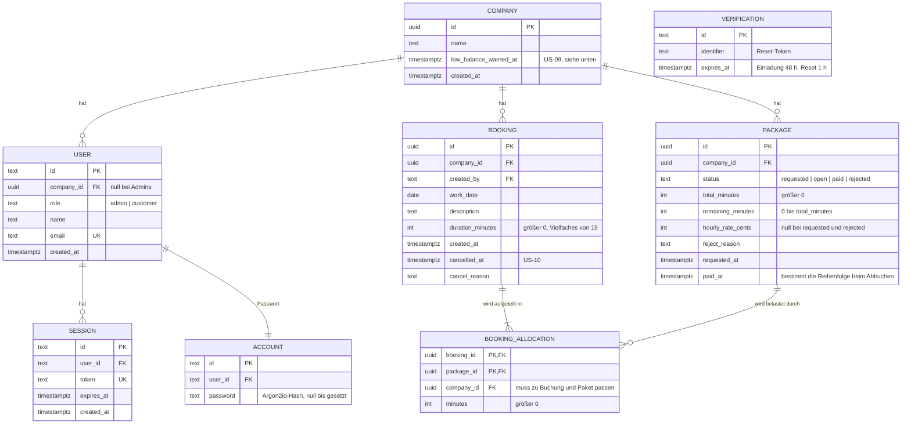
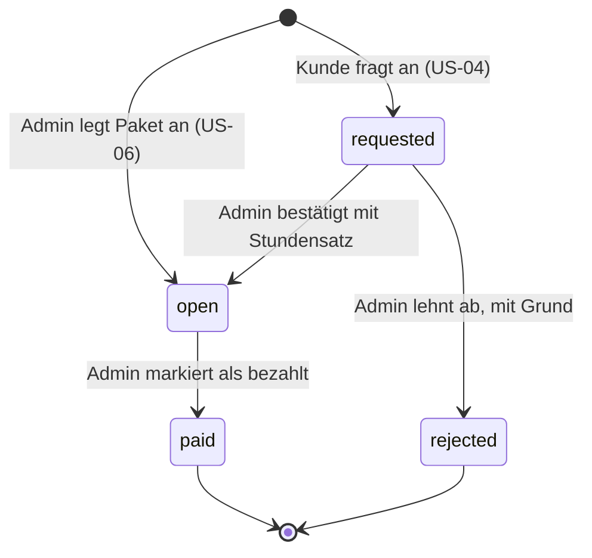
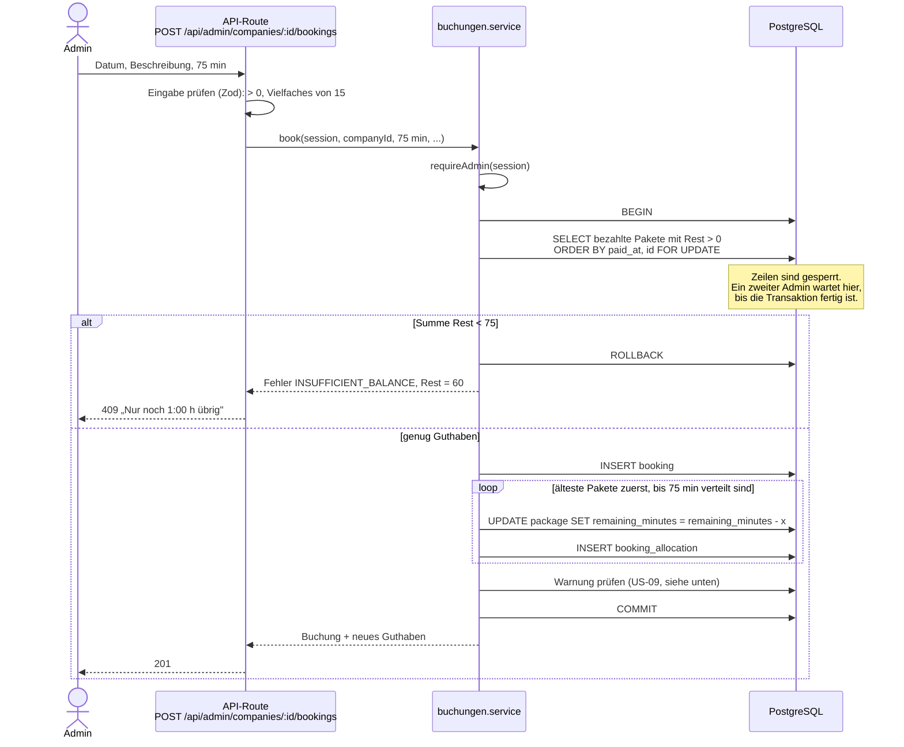

# Architektur

Dieses Dokument beschreibt, wie PrepaidHours aufgebaut ist und warum. Grundlage sind die Anforderungen aus `docs/requirements.md` und der MVP-Umfang aus `docs/mvp.md`. Die wichtigsten Entscheidungen stehen zusätzlich als ADRs in `docs/adr/`.

## Was die Architektur leisten muss

Aus den Anforderungen ergeben sich ein paar Punkte, die die Architektur stärker beeinflussen als der Rest:

- **Nie überbuchen (US-08, NFA-01):** Das Guthaben darf auch bei gleichzeitigen Buchungen nicht negativ werden. Das muss in der Datenbank abgesichert sein, nicht nur im Frontend. Das ist die wichtigste technische Anforderung.
- **Buchung auf mehrere Pakete aufteilen (US-07, FA-07):** Es wird immer zuerst vom ältesten bezahlten Paket abgezogen. Eine Buchung kann auf zwei Pakete aufgeteilt werden.
- **Daten getrennt halten (FA-02, NFA-02):** Ein Kunde darf nie Daten einer anderen Firma sehen, auch nicht über eine geänderte URL.
- **Zugang darf nicht verloren gehen (US-05, US-12):** Einladung und Passwort-Reset laufen über E-Mail-Links. Wenn eine E-Mail nicht ankommt, muss es einen zweiten Weg geben.
- **Klein und günstig:** Zwei Rollen, ein paar Seiten, wenige Benutzer. Hosting in der EU, wenig Kosten, und wir müssen es im Semester selbst bauen und betreiben können.

## Architekturvarianten

Wir haben zwei Varianten verglichen.

### Variante A: Modularer Monolith (Next.js + PostgreSQL)

Eine einzige Anwendung, die die Seiten rendert und die API bereitstellt. Innen ist sie in Module aufgeteilt (Auth, Firmen, Pakete, Buchungen, Benachrichtigungen). Jedes Modul hat eine Service-Schicht, und nur diese spricht mit der Datenbank. Es gibt eine PostgreSQL-Datenbank.

### Variante B: Getrenntes Frontend und Backend (React-SPA + REST-API + PostgreSQL)

Ein React-Frontend als Single-Page-App, das im Browser läuft, und ein eigenes Backend (z. B. Node.js mit Express) mit einer REST-API. Beides wird getrennt gebaut und deployt. Dazu dieselbe PostgreSQL-Datenbank.

### Vergleich

| Kriterium | A: Modularer Monolith | B: SPA + eigene API |
|---|---|---|
| Aufwand für uns | Gering: ein Projekt, eine Sprache, ein Deployment | Höher: zwei Projekte, zwei Builds, CORS und Token-Handling zwischen beiden |
| Sicherheit (NFA-02) | Session-Cookie im selben Origin, Berechtigungen werden auf dem Server geprüft, bevor die Seite gerendert wird | Token im Browser, jede API-Route muss extra abgesichert werden, mehr Stellen für Fehler |
| Überbuchungsschutz (NFA-01) | Gleich gut: liegt in beiden Fällen in der Datenbank-Transaktion | Gleich gut |
| Ladezeit (NFA-03) | Seiten kommen fertig gerendert vom Server, wenig JavaScript am Handy | Erst JavaScript laden, dann Daten holen, auf schwachen Handys langsamer |
| Hosting und Kosten | Ein Container + Datenbank | Zwei Dienste oder Static Hosting + API-Server |
| Später erweiterbar | Module lassen sich bei Bedarf herauslösen | Frontend und Backend schon getrennt, z. B. für eine eigene App |
| Passt zum Umfang | Ja | Überdimensioniert für zwei Rollen und ca. 12 Seiten |

Ein dritter Ansatz wären Microservices (je ein Dienst für Pakete, Buchungen, Mails). Den haben wir nicht genauer angeschaut. Die Überbuchungsprüfung braucht Pakete und Buchungen in **einer** Transaktion, und genau das wird schwer, wenn beide in getrennten Diensten liegen.

### Entscheidung

Wir nehmen **Variante A**. Der Hauptgrund ist, dass B uns mehr Arbeit macht, ohne eine Anforderung besser zu erfüllen. Der einzige Vorteil von B (eine eigene App kann dieselbe API benutzen) ist laut `mvp.md` bewusst ausgeschlossen. Details stehen in [ADR-001](adr/001-modularer-monolith-nextjs.md).

## Technologieauswahl

| Bereich | Wahl | Warum | Alternative, die wir verworfen haben |
|---|---|---|---|
| Sprache | TypeScript | Eine Sprache für Frontend und Backend, Typfehler fallen beim Bauen auf | JavaScript ohne Typen |
| Framework | Next.js (App Router) | Server-Rendering und API-Routen in einem Projekt, große Doku | Remix / React Router; vergleichbar, aber das Team kennt Next.js |
| Datenbank | PostgreSQL | Echte Transaktionen, `SELECT … FOR UPDATE` und `CHECK`-Constraints, die wir für NFA-01 brauchen | SQLite: einfacher, aber nur ein Schreiber gleichzeitig und schwächer im Betrieb mit mehreren Prozessen |
| Datenbankzugriff | Drizzle ORM + SQL-Migrationen | Nah an SQL, unterstützt `.for('update')` direkt, Migrationen sind lesbare SQL-Dateien | Prisma: verbreiteter, aber Zeilensperren gehen nur über Raw-SQL |
| Login | Better Auth (E-Mail + Passwort), Passwörter mit Argon2id über `@node-rs/argon2` | Sessions, Passwort-Reset, Rate-Limiting und CSRF-Schutz sind eingebaut, statt dass wir sie selbst schreiben. Siehe [ADR-004](adr/004-login-mit-better-auth.md). | Eigene Sessions (erster Entwurf), Auth.js |
| Formulare | Validierung mit Zod, auf dem Server | Dieselben Regeln (15-Minuten-Schritte, Werte > 0) im Formular und in der API | Nur HTML-Validierung im Browser: kann umgangen werden |
| E-Mail | Brevo (SMTP / API) | Firma in Frankreich, Server in der EU, Free-Plan mit 300 Mails pro Tag | Resend: gute API, aber US-Firma |
| Tests | Vitest (Logik), Playwright (Ablauf aus `mvp.md`) | Die Nebenläufigkeitstests laufen gegen eine echte PostgreSQL | Nur manuelle Tests |
| Betrieb | Docker Compose auf einem Hetzner-Server | Siehe `docs/hosting.md` und [ADR-003](adr/003-hosting-hetzner-docker-compose.md) | Managed PaaS |

## Architekturdiagramm

Die Diagramme folgen dem C4-Modell. Sie sind in Mermaid geschrieben, damit GitHub sie direkt anzeigt.

### Ebene 1: Systemkontext



### Ebene 2: Container



### Ebene 3: Komponenten in der Next.js-Anwendung



Regeln für die Module:

- **Seiten lesen, API-Routen schreiben.** Seiten rufen auf dem Server Lese-Funktionen der Services auf. Alles, was Daten ändert, läuft über genau eine API-Route. So gibt es für jede Änderung genau eine Tür.
- **Die Berechtigung wird im Service geprüft, nicht in der Middleware.** Jede Service-Funktion bekommt die Session und ruft als Erstes `requireAdmin(session)` oder `requireCustomer(session)` auf. Letzteres gibt die `companyId` aus der Session zurück, und nur mit dieser wird gefiltert, nie mit einer ID aus der URL (NFA-02). Eine Next.js-Middleware leitet nur nicht eingeloggte Benutzer auf die Login-Seite um. Sie ist keine Sicherheitsgrenze, weil eine falsch konfigurierte Middleware sonst Daten freigeben könnte.
- **Keine Geschäftslogik in Seiten und Routen.** Sie prüfen die Eingabe (Zod), rufen einen Service auf und zeigen das Ergebnis.
- **E-Mails werden nach dem Commit verschickt.** Schlägt der Versand fehl, wird das geloggt. Die Daten sind trotzdem gespeichert, und der Admin sieht offene Anfragen in seinem Eingang. Eine verlorene Einladung kann er neu schicken.

## Datenmodell

Die Tabellen `user`, `session`, `account` und `verification` legt Better Auth an. Wir erweitern `user` um `role` und `company_id`. Der Passwort-Hash liegt bei Better Auth in `account`.



Entscheidungen zum Datenmodell:

- **Zeiten in ganzen Minuten.** Gespeichert wird `int` und kein `decimal` oder `float`. 1:15 h sind 75. So gibt es keine Rundungsfehler, und „Vielfaches von 15" ist eine einfache `CHECK`-Bedingung. Angezeigt wird `h:mm`.
- **Geld in Cent.** `hourly_rate_cents` ist ein `int`, aus demselben Grund.
- **Restguthaben wird pro Paket gespeichert.** Das Guthaben eines Kunden ist die Summe von `remaining_minutes` über seine bezahlten Pakete. Warum wir das speichern und nicht jedes Mal ausrechnen, steht in [ADR-002](adr/002-ueberbuchungsschutz-in-der-datenbank.md).
- **Aufteilung über `booking_allocation`.** Eine Buchung über 1:00 h, die 0:30 h vom ersten und 0:30 h vom zweiten Paket nimmt, hat zwei Zeilen. So sieht man später genau, aus welchem Paket welche Minuten kamen, und eine Stornierung (US-10) kann die Minuten an genau diese Pakete zurückgeben.
- **Stornieren statt löschen (US-10, FA-10):** Buchungen werden nie gelöscht, nur mit `cancelled_at` und `cancel_reason` markiert. Abgelehnte Pakete bleiben ebenfalls gespeichert.

### Paketstatus (FA-04)



Nur `paid` zählt zum Guthaben (FA-03). Andere Übergänge gibt es nicht. Zum Beispiel kann ein bezahltes Paket nicht noch einmal bezahlt werden.

### Regeln, die die Datenbank selbst prüft

Was die Datenbank prüfen kann, prüft sie. Dann kann auch ein Fehler in unserem Code keine ungültigen Daten erzeugen.

| Constraint | Wofür |
|---|---|
| `CHECK (remaining_minutes BETWEEN 0 AND total_minutes)` | Guthaben nie negativ, Stornieren gibt nie mehr zurück als gekauft (NFA-01) |
| `CHECK (status = 'paid' OR remaining_minutes = 0)` | Nur bezahlte Pakete haben Guthaben (FA-03) |
| `CHECK (status IN ('requested','rejected') OR hourly_rate_cents > 0)` | Offene und bezahlte Pakete haben immer einen Stundensatz (US-06) |
| `CHECK (duration_minutes > 0 AND duration_minutes % 15 = 0)` | 15-Minuten-Schritte (FA-06) |
| `CHECK ((role = 'admin') = (company_id IS NULL))` | Admins gehören zu keiner Firma, Kunden zu genau einer |
| `UNIQUE (lower(email))` | Keine E-Mail doppelt (US-05) |
| Fremdschlüssel `(package_id, company_id)` und `(booking_id, company_id)` auf `booking_allocation` | Eine Buchung kann nie von einem Paket einer anderen Firma abbuchen (FA-02) |
| Trigger `package_rate_locked` | Blockiert jede Änderung von `hourly_rate_cents`, sobald das Paket nicht mehr `requested` ist (US-06) |
| Index `booking (company_id, work_date DESC)` | Verlauf schnell (NFA-03) |
| Index `package (company_id, status, paid_at, id)` | Abbuchen in der richtigen Reihenfolge |

## Abläufe, die Daten ändern

### Buchen (US-07, US-08)

Das ist der Kern. Alles passiert in **einer** Datenbank-Transaktion:



Zwei Sicherungen gegen das Überbuchen:

1. **Zeilensperre (`FOR UPDATE`):** Zwei gleichzeitige Buchungen für dieselbe Firma laufen nacheinander. Die zweite sieht schon das reduzierte Guthaben.
2. **`CHECK`-Constraint:** Würde trotzdem ein Paket unter 0 fallen (z. B. durch einen Fehler in unserem Code), bricht die Datenbank die ganze Transaktion ab.

### Statuswechsel nur einmal: bezahlt, bestätigt, abgelehnt, storniert

Ein Doppelklick auf „bezahlt" oder zwei Admins gleichzeitig dürfen nichts doppelt machen. Würde `mark-paid` zweimal laufen, würde `remaining_minutes` wieder auf die volle Stundenzahl gesetzt, und schon gebuchte Stunden wären wieder da. Deshalb ist jeder Statuswechsel ein **bedingtes Update**, das nur aus dem erlaubten Ausgangszustand heraus wirkt:

```sql
-- open → paid
UPDATE package SET status = 'paid', remaining_minutes = total_minutes, paid_at = now()
WHERE id = $1 AND company_id = $2 AND status = 'open'
RETURNING id;

-- Buchung stornieren (US-10)
UPDATE booking SET cancelled_at = now(), cancel_reason = $3
WHERE id = $1 AND company_id = $2 AND cancelled_at IS NULL
RETURNING id;
```

Kommt keine Zeile zurück, antwortet die API mit `409 INVALID_STATUS`. Die Datenbank wertet die `WHERE`-Bedingung für die zweite Anfrage erst aus, wenn die erste fertig ist. Deshalb kann nur eine von beiden gewinnen.

Beim Stornieren werden in derselben Transaktion die Minuten über `booking_allocation` an die Pakete zurückgegeben. Die Pakete werden dabei in **derselben Reihenfolge wie beim Buchen** gesperrt (`paid_at, id`). Eine Stornierung und eine Buchung, die gleichzeitig laufen, warten dann nur aufeinander und blockieren sich nicht gegenseitig (kein Deadlock). `id` ist der Tie-Breaker, falls zwei Pakete denselben `paid_at` haben (FA-07).

### Warnung bei wenig Guthaben (US-09)

- **Setzen:** In der Buchungstransaktion, wenn das neue Guthaben unter 120 Minuten liegt:
  `UPDATE company SET low_balance_warned_at = now() WHERE id = $1 AND low_balance_warned_at IS NULL RETURNING id`.
  Nur wenn eine Zeile zurückkommt, wird nach dem Commit die E-Mail verschickt. So geht sie auch bei gleichzeitigen Buchungen genau einmal raus.
- **Zurücksetzen** auf `NULL`, wenn das Guthaben wieder auf 120 Minuten oder mehr steigt, also bei `mark-paid` oder einer Stornierung. Danach kann wieder gewarnt werden.
- Eine Firma, die schon mit weniger als 2 h startet, wird bei ihrer ersten Buchung gewarnt.

### Einladung und Passwort-Reset (US-05, US-12)

Beides verwendet denselben Mechanismus von Better Auth (Reset-Token in `verification`):

- **Kunde anlegen:** Benutzer ohne Passwort anlegen, dann einen Reset-Link mit 48 h Gültigkeit als Einladung schicken.
- **Einladung erneut senden:** Alte Tokens des Benutzers löschen, neuen Link mit 48 h schicken.
- **Passwort vergessen:** Link mit 1 h Gültigkeit. Die Antwort ist immer dieselbe, egal ob die E-Mail existiert.
- **Nach dem Setzen eines Passworts** werden alle Sessions des Benutzers gelöscht.

## API-Design

REST mit JSON. Seiten lesen über die Services auf dem Server. Alle Änderungen laufen über die folgenden Routen. Authentifiziert wird über das Session-Cookie von Better Auth (`HttpOnly`, `Secure`, `SameSite=Lax`).

### Auth (von Better Auth bereitgestellt)

| Methode | Pfad | Wer | Zweck | Story |
|---|---|---|---|---|
| POST | `/api/auth/sign-in/email` | alle | E-Mail + Passwort → Session-Cookie | US-01 |
| POST | `/api/auth/sign-out` | eingeloggt | Session löschen | US-01 |
| POST | `/api/auth/request-password-reset` | alle | Reset-Link per E-Mail, Antwort immer gleich | US-12 |
| POST | `/api/auth/reset-password` | mit Link | Token + neues Passwort | US-05, US-12 |

Selbst registrieren ist abgeschaltet (`disableSignUp`). Kunden legt nur der Admin an.

### Kunde (Firma kommt immer aus der Session)

| Methode | Pfad | Zweck | Story |
|---|---|---|---|
| POST | `/api/me/packages` | Paket anfragen `{ hours }` | US-04 |
| GET | `/api/me/bookings.csv` | Verlauf als CSV-Download | US-11 |

### Admin

| Methode | Pfad | Zweck | Story |
|---|---|---|---|
| POST | `/api/admin/companies` | Firma + Kunden anlegen `{ companyName, name, email }`, verschickt Einladung | US-05 |
| POST | `/api/admin/users/:id/resend-invite` | Neue Einladung, alter Link wird ungültig | US-05 |
| POST | `/api/admin/companies/:id/packages` | Paket anlegen `{ hours, hourlyRateCents }` → `open` | US-06 |
| POST | `/api/admin/packages/:id/confirm` | Anfrage bestätigen `{ hourlyRateCents }`: `requested` → `open` | US-04, US-06 |
| POST | `/api/admin/packages/:id/reject` | Anfrage ablehnen `{ reason }`: `requested` → `rejected` | US-04 |
| POST | `/api/admin/packages/:id/mark-paid` | `open` → `paid`, Guthaben steigt | US-06 |
| POST | `/api/admin/companies/:id/bookings` | Arbeit buchen `{ workDate, description, durationMinutes }` | US-07, US-08 |
| POST | `/api/admin/bookings/:id/cancel` | Buchung stornieren `{ reason }` | US-10 |

### Betrieb

| Methode | Pfad | Zweck |
|---|---|---|
| GET | `/api/health` | Prüft App und Datenbankverbindung, für den Uptime-Check |

Für Statuswechsel verwenden wir eigene Aktionen (`/confirm`, `/reject`, `/mark-paid`, `/cancel`) statt eines allgemeinen `PATCH`. Jeder erlaubte Übergang aus dem Zustandsdiagramm hat genau eine Route, und es gibt keine Route, über die man den Stundensatz nachträglich ändern könnte.

### Seiten

| Pfad | Wer | Zeigt | Story |
|---|---|---|---|
| `/login`, `/passwort-vergessen`, `/passwort-setzen` | alle | Login, Reset anfordern, Passwort setzen | US-01, US-05, US-12 |
| `/` | Kunde | Guthaben, wartende Pakete, letzte Buchungen | US-02, US-03 |
| `/verlauf` | Kunde | Alle Buchungen, 50 pro Seite, CSV-Download | US-03, US-11 |
| `/paket-anfragen` | Kunde | Formular | US-04 |
| `/admin` | Admin | Eingang: offene Anfragen aller Firmen, Firmen mit wenig Guthaben | US-04 |
| `/admin/firmen`, `/admin/firmen/[id]` | Admin | Firmen, Pakete, Buchungen, Buchungsformular | US-05 bis US-10 |

### Antworten und Fehler

Fehler haben immer dieselbe Form:

```json
{ "error": { "code": "INSUFFICIENT_BALANCE", "message": "Nur noch 1:00 h Guthaben übrig.", "remainingMinutes": 60 } }
```

| HTTP | Code | Wann |
|---|---|---|
| 400 | `VALIDATION_ERROR` | Eingabe ungültig, z. B. 20 Minuten oder Stundensatz 0 |
| 400 | `INVALID_TOKEN` | Link ungültig, schon benutzt oder abgelaufen. Eine Meldung für alle drei Fälle, damit man nicht herausfinden kann, welche Tokens es gibt. |
| 401 | `UNAUTHENTICATED` | Nicht eingeloggt oder falsche Login-Daten (gleiche Meldung für unbekannte E-Mail und falsches Passwort, US-01) |
| 403 | `FORBIDDEN` | Kunde ruft Admin-Route auf, oder `Origin`-Header passt nicht |
| 404 | `NOT_FOUND` | Gibt es nicht **oder** gehört zu einer anderen Firma. Wir verraten nicht, dass es die ID gibt (NFA-02). |
| 409 | `INSUFFICIENT_BALANCE` | Buchung größer als Guthaben (US-08) |
| 409 | `EMAIL_TAKEN` | E-Mail schon vergeben (US-05) |
| 409 | `INVALID_STATUS` | Übergang nicht erlaubt oder schon passiert, z. B. zweites `mark-paid` |
| 415 | `UNSUPPORTED_MEDIA_TYPE` | Änderung ohne `Content-Type: application/json` |
| 429 | `RATE_LIMITED` | Zu viele Versuche bei Login oder Reset |

## Sicherheit

| Thema | Maßnahme |
|---|---|
| Passwörter (NFA-02) | Argon2id über `@node-rs/argon2` (liefert fertige Binaries, keine Build-Probleme im Docker-Image). Mindestens 10 Zeichen. Better Auth hasht standardmäßig mit scrypt, das wir per Konfiguration ersetzen, weil NFA-02 bcrypt oder Argon2 verlangt. |
| Passwort raten | Rate-Limit von Better Auth: Login 5 Versuche pro Minute und IP, Reset 3 pro Stunde. Gespeichert in der Datenbank, damit es einen Neustart übersteht. |
| Sessions | Neue Session bei jedem Login, 7 Tage gültig, serverseitig löschbar. Alle Sessions werden gelöscht, wenn ein Passwort gesetzt wird. |
| CSRF | `SameSite=Lax` + Prüfung des `Origin`-Headers (`trustedOrigins` in Better Auth und bei unseren Routen) + Änderungen nur mit `Content-Type: application/json`. Ein fremdes HTML-Formular kann also keine Buchung auslösen. |
| Fremde Daten (FA-02) | `companyId` kommt nur aus der Session (`requireCustomer`), fremde IDs geben 404, Fremdschlüssel mit `company_id` auf `booking_allocation` |
| E-Mail-Enumeration | Gleiche Meldung bei Login-Fehlern (US-01), bei Passwort vergessen und bei ungültigen Tokens |
| Geheimnisse | Nur in `.env` auf dem Server, nie im Repository (`.gitignore`) |

## Wie die Architektur die nichtfunktionalen Anforderungen erfüllt

| NFA | Wie | Test |
|---|---|---|
| NFA-01 Nie negativ | Transaktion mit `FOR UPDATE` + `CHECK`, Statuswechsel als bedingte Updates, siehe ADR-002 | 10 parallele Buchungen zu 1 h auf 5 h Guthaben: genau 5 gehen durch. Dazu: zweimal parallel `mark-paid` und zweimal parallel `cancel`, jeweils genau einmal erfolgreich. Gegen echte PostgreSQL. |
| NFA-02 Sicherheit | Siehe Abschnitt Sicherheit | Kunde A ruft Daten von Kunde B auf → 404. Kunde ruft Admin-Route auf → 403. |
| NFA-03 < 2 s bei 1000 Buchungen | Guthaben ist eine Summe über wenige Pakete (nicht über alle Buchungen), Verlauf mit Index und 50 pro Seite, Server-Rendering | Messung mit Seed-Daten (1000 Buchungen) |
| NFA-04 Handy ab 360 px | Ein Layout mit einer Spalte, Tabellen werden am Handy zu Karten | Playwright mit 360 px Breite |

## Risiken und offene Punkte

| Risiko | Umgang |
|---|---|
| Verfallen Pakete? (offen aus Phase 1) | Das Datenmodell lässt es zu, später ein `expires_at` auf `package` zu ergänzen und abgelaufene Pakete beim Abbuchen auszuschließen. Bis zur Klärung verfallen sie nicht. |
| E-Mails landen im Spam | SPF und DKIM für die Absender-Domain bei Brevo einrichten, bevor der erste echte Kunde eingeladen wird |
| Ein Server fällt aus | Tägliche Backups auf einem anderen System, Wiederherstellung vor der MVP-Demo einmal geübt (siehe `hosting.md`) |
| Better Auth ändert sich | Version im `package.json` fest pinnen, Updates nur bewusst |

## Projektstruktur (geplant)

```
src/
  app/                    Seiten und API-Routen (Next.js App Router)
    (kunde)/              Dashboard, Verlauf, Paket anfragen
    admin/                Eingang, Firmen, Pakete, Buchen
    api/                  REST-Routen wie oben, api/auth/[...all] für Better Auth
  modules/
    auth/                 better-auth.ts (Konfiguration), guards.ts (requireAdmin, requireCustomer)
    firmen/               service.ts
    pakete/               service.ts
    buchungen/            service.ts, allocate.ts (Aufteilen auf Pakete)
    benachrichtigungen/   service.ts, mailer.ts (Brevo, lokal nur Konsole)
  db/
    schema.ts             Drizzle-Schema
    migrations/           SQL-Migrationen (inkl. CHECKs und Trigger)
tests/
  unit/                   Vitest
  integration/            Vitest gegen PostgreSQL in Docker (Nebenläufigkeit, Berechtigungen)
  e2e/                    Playwright, Ablauf aus mvp.md
```
